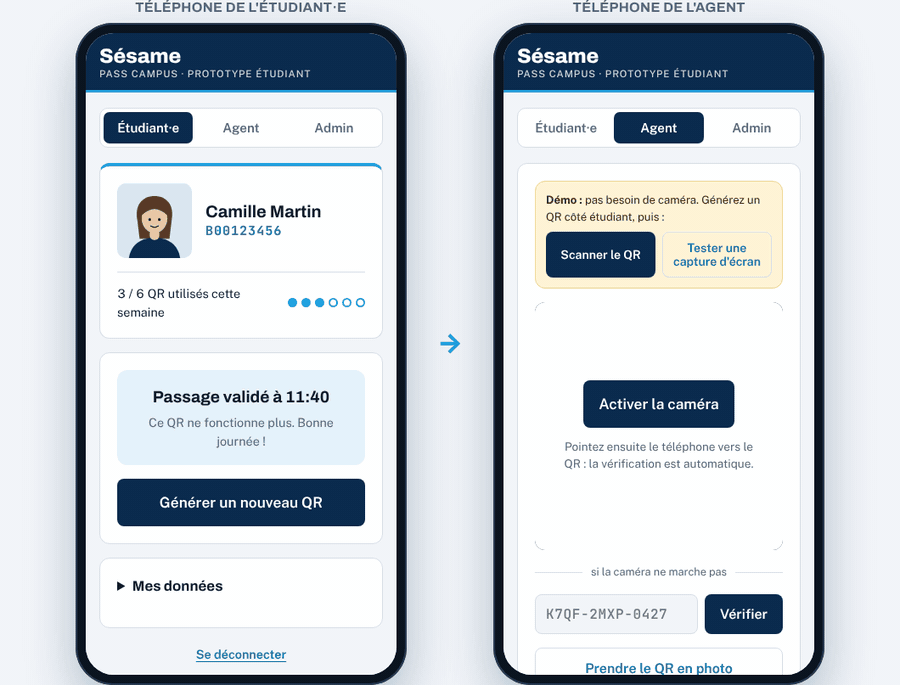
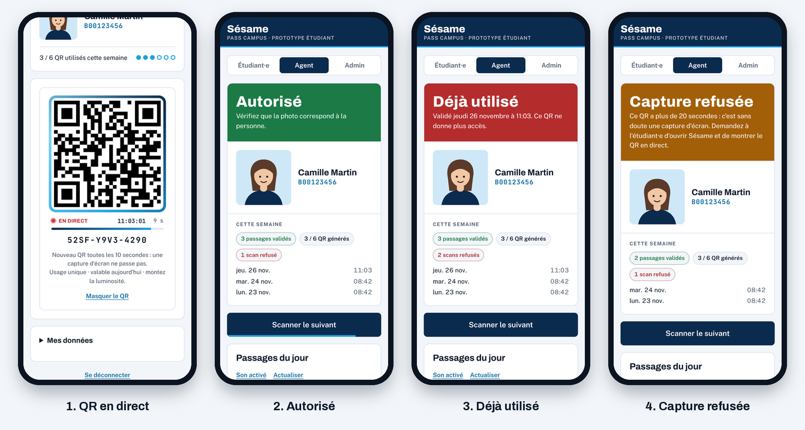
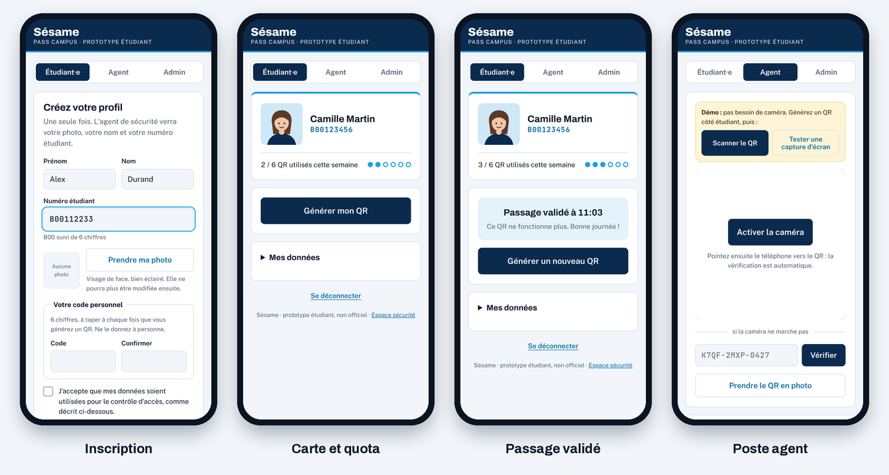

# Sésame

**Le pass campus pour les jours où l'on a oublié sa carte étudiante.**

L'étudiant·e génère un QR code sur son téléphone, l'agent de sécurité le scanne et voit sa photo. 
Usage unique, nouveau QR toutes les 10 secondes, chaque passage est tracé.

[**▶ Essayer la démo**](https://sesame-campus.github.io/sesame/demo.html) · [Comment ça marche](#comment-ça-marche) · [La démarche](#la-démarche) · [Où en est le projet](#où-en-est-le-projet)

 

Projet étudiant né à l'ESSEC Business School · prototype non officiel · données de la démo fictives

---

## Le problème

Sur le campus, on entre avec sa carte étudiante. Quand on l'oublie, il faut passer par l'accueil sécurité. C'est long pour l'étudiant·e, ça fait du travail en plus pour les agents, et l'entrée n'est pas tracée.

Une carte étudiante 100 % numérique serait idéale, mais elle est hors de portée à court terme : les portiques actuels ne savent pas lire un téléphone, et un changement de matériel prend des années.

**Sésame résout le cas le plus fréquent, tout de suite, sans nouveau matériel** : l'agent scanne le QR avec un téléphone et vérifie l'identité avec la photo.

## Essayer en 30 secondes

👉 **[sesame-campus.github.io/sesame/demo.html](https://sesame-campus.github.io/sesame/demo.html)**

La démo affiche les deux téléphones côte à côte, avec des profils fictifs. Rien n'est envoyé en ligne.

| | Code |
|---|---|
| Code personnel de Camille (étudiante) | `246810` |
| PIN du poste agent | `2580` |
| Espace sécurité (admin) | `demo-sesame` |

Essayez de tricher : rescannez le même QR, ou cliquez sur « Tester une capture d'écran ».

## Comment ça marche

**Côté étudiant·e**
- Inscription une seule fois : adresse mail de l'école (vérifiée par un code reçu par mail), nom, numéro étudiant (B00) et photo.
- Un **code personnel à 6 chiffres** est demandé à chaque génération de QR : un téléphone prêté ou volé ne suffit pas.
- **6 QR par semaine maximum**, avec des alertes avant la limite : Sésame dépanne, il ne remplace pas la carte.

**Côté agent de sécurité**
- Le poste est protégé par un PIN. L'agent vise le QR avec la caméra : le verdict s'affiche tout seul, avec un son et une vibration.
- Il voit la **photo, le nom et le B00**, ainsi que les passages de la semaine de l'étudiant·e.
- Si la caméra ne marche pas : un code à taper à la main, ou une photo du QR.

**Côté équipe sécurité**
- Un espace admin : statistiques, historique complet avec recherche et export CSV, gestion des comptes (bloquer, demander une nouvelle photo, réinitialiser le code personnel), réglages.

## Pourquoi une capture d'écran ne passe pas

Il fallait éviter qu'un étudiant envoie son QR à un ami. Un site web ne peut pas bloquer les captures d'écran, alors **on les a rendues inutiles** :

1. **Le QR change toutes les 10 secondes.** Il contient une signature calculée sur le téléphone avec une clé secrète, reçue seulement après le code personnel. Le serveur refuse un QR de plus de 20 secondes : l'agent voit « Capture refusée ».
2. **Le QR est animé.** Le contour tourne et l'heure défile à la seconde : l'agent voit tout de suite si l'écran est vivant ou figé.
3. **Chaque QR ne sert qu'une fois** et expire à minuit. Un deuxième scan affiche « Déjà utilisé », avec l'heure du premier passage.

## La démarche

Sésame est né pendant **un séminaire d'entrepreneuriat de trois jours** à l'ESSEC, en équipe de trois.

- **Jour 1 : trouver le bon problème.** Après un premier brainstorming trop large, on s'est recentrés sur notre campus et sur un problème que presque tout le monde a vécu : oublier sa carte. Notre première idée était une carte étudiante entièrement numérique. Les étudiants adoraient, mais nos intervenants nous ont conseillé de **résoudre 20 % du problème, mais bien**, plutôt que 100 % mal. On a donc choisi le QR code.
- **Jour 2 : tester.** Premier prototype testé avec des étudiants : on espérait convaincre environ 30 % d'entre eux, presque tous ont adhéré. Puis rencontre avec le service sécurité du campus : il nous a confirmé que la carte numérique bloquait depuis des années (les portiques ne lisent pas les téléphones) et que Sésame apportait **la traçabilité** qui leur manquait.
- **Jour 3 : mesurer et convaincre.** Retours collectés par formulaire, nouveaux engagements, puis pitch final. Le responsable du service sécurité nous a demandé **un rendez-vous de suivi avec sa hiérarchie**.

Ce que les retours ont changé dans l'appli :
| Retour | Ce qu'on a fait |
|---|---|
| « N'importe qui peut taper le B00 de quelqu'un d'autre » | Connexion par l'adresse mail de l'école + code personnel |
| « Il ne faut pas que ça remplace la carte » | Limite de QR par semaine, alertes, renvoi vers le registraire |
| « On doit pouvoir tracer chaque entrée » | Historique complet, espace sécurité, export CSV |
| « Et si on envoie une capture à un ami ? » | QR qui change toutes les 10 secondes |
| Données personnelles | Notice RGPD, consentement, suppression du compte en un clic |

## Où en est le projet

- ✅ Prototype fonctionnel, testé avec des étudiants et le service sécurité du campus.
- 🤝 **En suivi avec le service sécurité** pour envisager un pilote.
- 🔜 Prochaines étapes : accord de l'école, connexion avec le compte ESSEC (SSO), puis, à terme, lecture directe par les portiques.

## Technique

| | |
|---|---|
| Front | HTML, CSS et JavaScript sans framework · appli installable (PWA) |
| Base de données | [Supabase](https://supabase.com) (PostgreSQL) : toutes les règles sont vérifiées côté serveur, dans des fonctions SQL. Le site ne lit jamais les tables directement (Row Level Security). |
| Sécurité | Code mail à usage unique, code personnel chiffré (bcrypt), blocage après plusieurs erreurs, QR signés par HMAC-SHA256 |
| QR | Génération et lecture dans le navigateur ([qrcode-generator](https://github.com/kazuhikoarase/qrcode-generator), [jsQR](https://github.com/cozmo/jsQR)) |
| Hébergement | Netlify pour l'appli, GitHub Pages pour la démo |

Développé avec l'aide de l'IA (Claude) : l'équipe a défini le produit, les règles et les choix, testé avec les utilisateurs et itéré à partir de leurs retours.

<b>Organisation du dépôt et installation</b>

| Fichier | Rôle |
|---|---|
| `site/` | L'appli : étudiant, agent (`#agent`) et espace sécurité (`admin.html`) |
| `site/demo.html`, `site/demo-server.js` | La démo : même appli, avec une base simulée dans le navigateur |
| `site/config.js` | Adresse Supabase et clé **publique** (elle est faite pour être visible) |
| `supabase.sql` | La base de données : tables, règles et droits d'accès |
| `GUIDE.md` | Le guide de mise en ligne pas à pas |

Pour installer sa propre version : suivre [`GUIDE.md`](GUIDE.md) (environ 30 minutes).

## L'équipe

- **Lorraine Guarnotta**
- **Gabriel Borin**
- **Mathieu Vassette**

Étudiant·es à l'ESSEC Business School. Une question, une idée ? Écrivez-nous : testsesame22@gmail.com

---

In English: Sésame is a student project from ESSEC Business School. Students who forgot their ID card generate a single-use QR code on their phone; a security guard scans it and sees their photo. The QR code changes every 10 seconds, so screenshots are rejected. Try the <a href="https://sesame-campus.github.io/sesame/demo.html">live demo</a> with fictional profiles.
